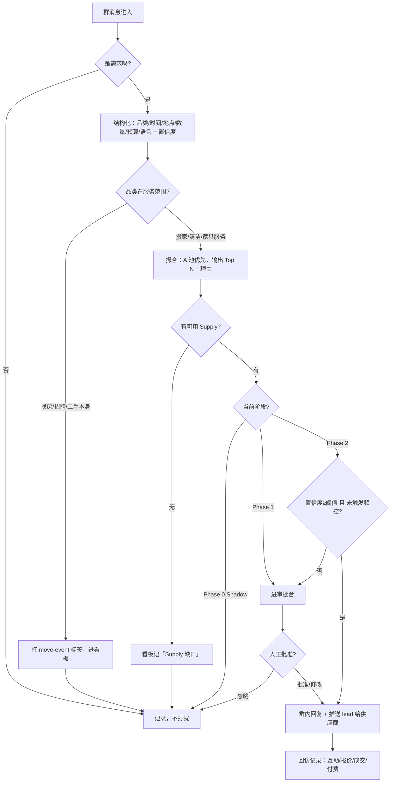

# London Matching Bot 产品需求文档

| 项             | 内容                                                                                                                                                                                               |
| -------------- | -------------------------------------------------------------------------------------------------------------------------------------------------------------------------------------------------- |
| 版本           | v2.0（2026-09-21）。v1.x 是「有闲」企微二手客服的需求稿，商业场景调研不足；本版依据 `London_Matching_Bot_Project_Brief.docx`（v0.1）重写，品类、渠道、收费方、阶段节奏全部以 Brief 为准            |
| 产品形态       | 驻留在伦敦本地生活 Telegram 群里的供需撮合 Bot，配一个运营审批台                                                                                                                                   |
| 上位文档       | [London_Matching_Bot_Project_Brief.docx](./London_Matching_Bot_Project_Brief.docx) —— 商业逻辑、Supply Seed（30 家供应商）、Demand Channel Seed（15 个群）、两周计划。本文不重复其中的清单，只引用 |
| 本文回答的问题 | Brief 说清了「做什么、为什么、先在哪做」；本文回答「用户会看到什么、Bot 什么时候开口、人怎么管它、怎么判断做对了」                                                                                 |

---

## 1. 背景与问题

伦敦每天都有人在「落地 / 搬家 / 退租」这条事件链上，而他们的第一反应是在群里问：

- 「有人认识 van 司机吗，周六 E14 搬到 SE1，8 个箱子」
- 「退租要做 end-of-tenancy cleaning，有推荐吗，1-bed」
- 「刚在群里买了张床，谁能帮运一下」

这些需求高度自然语言化、时效强（same-day / next-day）、可结构化（时间、起点、终点、postcode、数量、预算），但当下的承接方式是「等群友接话」——大多数时候没人接，需求就散了。另一头，Man & Van、清洁、家具安装这类供应商高度碎片化，早就习惯为 lead 付费，却拿不到群里这种第一现场的需求。

**核心命题**：把群聊里「问群友」式的即时需求，变成「立即获得 3 个可交易选项」。群聊提供实时 Demand，公开网络补充 Supply，AI 负责理解、结构化、匹配和引荐。

**第一阶段不碰支付和履约。**

## 2. 产品定位与核心用户价值

**一句话定位**：本地服务型 Marketplace 的需求获取与撮合层。产品边界是 **Discover → Match → Introduce**：发现需求、匹配供应商、把双方介绍到一起，之后由用户与供应商自己沟通、报价、付款、履约。

它**不是**群消息搜索 Bot，**不是**租房中介，**不是**二手交易平台。

### 2.1 首发市场与品类（沿用 Brief §0–§1）

| 维度         | 选择                                                                                                                            |
| ------------ | ------------------------------------------------------------------------------------------------------------------------------- |
| 城市         | London                                                                                                                          |
| 人群         | international students + immigrants / expats（俄语、乌克兰语、葡语、印度、华人等社区群）                                        |
| 渠道         | Telegram 群（后续可扩 WhatsApp）                                                                                                |
| 付费品类     | Man & Van / 小型搬家；End-of-tenancy Cleaning；Furniture delivery / assembly / removal                                          |
| 免费入口品类 | 找房 / 转租、二手买卖、生活互助——不收费，作为 **move-event detector**：谁在找房、退租、买二手家具，后面就会出现一串付费服务需求 |
| 后续品类     | Handyman / daily cleaning / storage                                                                                             |

### 2.2 用户价值

| 角色               | 核心痛点                                                  | 我们给的价值                                                |
| ------------------ | --------------------------------------------------------- | ----------------------------------------------------------- |
| 需求方（群成员）   | 在群里问一句常常没人接；自己去搜要挨个打电话比价          | 问一句，收到 2–3 个能直接联系、带价格区间的供应商选项       |
| 供给方（Supplier） | 本地小商家 / 个体司机，没有稳定客源，付费买 lead 质量参差 | 收到已结构化的高意图 lead（时间、起点、终点、量），直接报价 |
| 群管理员           | 群里广告泛滥，助手要么刷屏要么没用                        | 一个只在有明确需求时出现、可被管理员控制的「群内匹配助手」  |
| 运营               | 不知道群里需求到底多不多、AI 判得准不准                   | 一个看得见每条需求、每次匹配、每次回复效果的审批台          |

### 2.3 业务价值

- **实时 Demand Graph**：项目最终最值钱的资产不是 Bot，而是「谁今天在搬家、谁明天要清洁」这张实时需求图（Brief §7）；
- **供给侧收费**：变现路径按 Brief §1.5——验证期免费 → £5–15 / qualified lead → 月包 → 抽佣；
- **免费入口带付费服务**：二手床撮合成功后推荐家具运输，找房群里识别搬家事件后接搬家 / 清洁需求。

## 3. 产品架构

从用户与运营能感知的视角，产品分五层：

```
┌────────────────────────────────────────────────────────┐
│ 触达层  Telegram 群（首批 8 个实验群，见 Brief §4）        │
│   · 群内回复：在需求消息下回帖，给出 2–3 个供应商选项       │
│   · 私聊承接：用户点开 Bot 后补充细节 / 收取完整匹配        │
├────────────────────────────────────────────────────────┤
│ 理解层  Demand Extraction                               │
│   · 这条消息是不是需求？属于哪个品类？                      │
│   · 抽取：时间、起点、终点、postcode、数量、预算、语言       │
│   · 给出置信度                                            │
├────────────────────────────────────────────────────────┤
│ 撮合层  Supply Retrieval + Matcher                       │
│   · 从供应商库（A 池优先，B 池补充）取候选                  │
│   · 按服务区域、档期、价格类型、语言打分，输出 Top N + 理由  │
├────────────────────────────────────────────────────────┤
│ 把关层  Human-in-the-loop + 出站判断                      │
│   · Phase 0：只记录，不发                                │
│   · Phase 1：人工批准 / 修改 / 忽略后才发                  │
│   · Phase 2：置信度阈值 + 频控 自动发，人工抽检             │
├────────────────────────────────────────────────────────┤
│ 运营层  审批台 / 供应商库 / Demand 看板 / 群配置            │
└────────────────────────────────────────────────────────┘
```

**分阶段放行**是本产品最重要的结构决策：Bot 的「开口权」随验证进度逐级释放，而不是一上来就自动回复。

## 4. 用户与核心场景

### 4.1 角色

| 角色        | 说明                                                                   |
| ----------- | ---------------------------------------------------------------------- |
| 需求方      | 群成员，在群里用自然语言（多语种）表达需求，不需要学任何指令           |
| 供应商 A 池 | 已联系并明确愿意接结构化 lead 的商家（目标 10–15 家，首批至少 3–5 家） |
| 供应商 B 池 | 公开可联系、尚未确认愿意接 lead 的商家（Brief §3 的 30 家为种子）      |
| 运营        | 维护供应商库、审批匹配、看 Demand 看板、决定 Go / Pivot                |
| 群管理员    | 决定 Bot 能否进群、以什么姿态出现；A1 群优先做管理员 BD                |

### 4.2 核心场景故事

**场景 A · Man & Van（付费主品类）**

> 周四晚，@london_housing 群里有人发「I need someone with a van this Sunday, moving from E14 to SE1, around 8 boxes」。Bot 抽取：Intent = Man & Van，Date = Sunday，From = E14，To = SE1，Confidence = 0.94。撮合层从 A 池挑出 3 家覆盖东南伦敦、周末不加价的供应商。Phase 1 下运营在审批台点「批准」，Bot 在该消息下回复：3 家的名字、价格区间、联系方式，并提示「直接联系他们报价」。同时，A 池供应商收到一条结构化 lead。

**场景 B · 退租清洁（付费主品类）**

> 有人在乌克兰语群里问退租清洁推荐，1-bed，下周。Bot 识别 End-of-tenancy Cleaning，匹配 2 家报 1-bed 固定价、带 72h guarantee 的清洁公司。回复用与提问者相同的语言。

**场景 C · 二手带出运输（免费入口 → 付费服务）**

> 二手群里 A 卖床，B 说「要了」。这笔二手交易 Bot 不插手、不收费。但它识别到「买了张床、需要运」这个衍生需求，向 B 私聊推荐 2 家能做单件家具配送的 Man & Van。

**场景 D · 找房作为搬家探测器（免费入口，不回复）**

> 找房群里有人发「找 3 月 1 号起的房，Stratford 附近」。Bot 不回复——租房不是它的业务。但它记下这是一个即将发生的 move-event，放进 Demand 看板；等这个人后续在任何接入群里提到搬家或清洁，撮合层优先响应。

**场景 E · 供应商侧收 lead**

> A 池的一家搬家公司通过 WhatsApp 收到：「Lead #182 · Man & Van · Sun · E14 → SE1 · ~8 boxes · 用户 Telegram 联系方式」。它直接联系用户报价。运营后续回访：有没有报价、有没有成交，用于 §9 的漏斗。

### 4.3 场景的边界

- **不做租房撮合、不做招聘撮合**：只发现、不担保、不代收款、不背书身份（高诈骗风险类别）；
- **不碰钱**：不报价承诺、不托管支付、不担保服务质量、不处理履约纠纷；
- **不跨群搬运个人信息**：只处理群内为撮合目的公开表达的需求，敏感信息不做不必要的跨群传播；
- **未经群管理员许可不自动回复**；
- 换汇、虚拟货币、代付等敏感类目一律不匹配。

## 5. 功能清单

按放行阶段排列。Phase 0 是两周计划里 Day 4–8 的 Shadow 阶段，Phase 1 是 Day 7–14，Phase 2 是 Go 决策之后。

| #   | 功能                    | 说明（用户 / 运营语言）                                                           | 阶段 | 优先级 |
| --- | ----------------------- | --------------------------------------------------------------------------------- | ---- | ------ |
| F1  | 群消息采集              | 接入首批 8 个实验群，全量收原始消息流（Telegram；后续 WhatsApp）                  | 0    | P0     |
| F2  | Demand 识别与结构化     | 判断是否需求、品类、时间 / 起点 / 终点 / postcode / 数量 / 预算 / 语言，带置信度  | 0    | P0     |
| F3  | Demand 看板             | 按天看：识别了多少需求、各品类多少、各群 / 语言社区差异；每条需求可展开看抽取结果 | 0    | P0     |
| F4  | 供应商库                | 录入 B 池、标记 A 池；字段见 §11；支持按品类、区域、价格类型筛选                  | 0    | P0     |
| F5  | 撮合与理由              | 对每条需求输出 Top N 供应商及匹配理由（区域覆盖、档期、价格、语言）               | 0    | P0     |
| F6  | 审批台                  | 待发送建议列表：批准 / 修改回复文案 / 忽略；记录审批人和结果                      | 1    | P0     |
| F7  | 群内回复                | 在需求消息下回帖：2–3 个选项 + 价格区间 + 联系入口；说明影响选择的具体未知，不追加统一免责尾注                     | 1    | P0     |
| F8  | 多语种回复              | 用提问者的语言回复（俄 / 乌 / 葡 / 中 / 英）                                      | 1    | P0     |
| F9  | Supplier lead 推送      | 把结构化 lead 发给 A 池供应商（WhatsApp / Telegram / 电话文本）                   | 1    | P0     |
| F10 | 私聊承接                | 用户点开 Bot 后补充信息、收完整匹配；场景 C 的衍生推荐走私聊                      | 1    | P1     |
| F11 | 成交回访记录            | 运营记录每个 lead 的后续：报价了吗、成交了吗、供应商愿付吗                        | 1    | P1     |
| F12 | 自动回复（阈值 + 频控） | 置信度 ≥ 阈值且该群近 N 小时未回复过才自动发；其余仍进审批台                      | 2    | P1     |
| F13 | 群级配置                | 每个群单独设置：只监听 / 需审批 / 自动回复；品类白名单；管理员联系人              | 2    | P1     |
| F14 | move-event 关联         | 找房 / 二手需求打上「潜在搬家事件」标签，同一用户后续需求优先响应                 | 2    | P2     |
| F15 | 供应商收费              | qualified lead 计数与账单（£5–15 / lead），为月包做准备                           | 2    | P2     |

## 6. 核心流程

### 6.1 正向：一条群消息的旅程



### 6.2 逆向：Bot 什么时候不说话

沉默是产品决策，不是故障。群管理员关系是第一阶段最脆弱的资产，多嘴一次可能被踢出群。

| 场景                        | 行为                                 | 设计理由                                      |
| --------------------------- | ------------------------------------ | --------------------------------------------- |
| Phase 0 全程                | 一句不说                             | 先证明群里有需求、AI 判得准，再谈开口         |
| 闲聊、寒暄、资讯转发        | 不接                                 | 群 Bot 的头号罪是刷屏                         |
| 需求置信度低于阈值          | 不接，进审批台或只记录               | 说错不如不说                                  |
| 找房、招聘、二手交易本身    | 不接，打标签                         | 不是我们的业务；高风险类别只发现不介入        |
| 该群短时间内已回复过        | 不接（频控）                         | 一个群一天出现三次就是广告机器人              |
| 匹配不到 A 池、只有 B 池    | Phase 1 由人工决定；Phase 2 不自动发 | B 池只代表公开可找到，档期、价格、质量未验证  |
| 群管理员未许可 / 设为只监听 | 不接                                 | 管理员是入口的守门人                          |
| 用户表达反感                | 该群降级为需审批，不争辩             | Bot 跟人吵是公关事故                          |
| 系统故障                    | 本轮静默                             | 不发「服务不可用」——群里没人需要知道 Bot 存在 |

用户体感目标：**Bot 的每一次出现都应该像一个热心群友精准递了三张名片，而不是一个广告号。**

### 6.3 异常与保护

| 情况                                    | 用户 / 运营体验                                                  | 保护机制                                                        |
| --------------------------------------- | ---------------------------------------------------------------- | --------------------------------------------------------------- |
| 抽取字段缺失（没说时间 / 地点）         | 群内不回复；Phase 1 起可私聊追问一句                             | 缺关键字段不硬匹配                                              |
| 供应商信息过期（电话打不通 / 价格变了） | 运营在回访里标记                                                 | 供应商记录带 `last_verified`，超期降权，连续两次无响应移出 A 池 |
| 推荐的供应商不覆盖该 postcode           | 不会发生                                                         | 匹配只用 `service_area` 命中的候选                              |
| 回复语言与提问者不一致                  | 不会发生                                                         | 语言字段作为回复语言的硬约束                                    |
| 用户把 Bot 回复当成平台担保             | 按选项说明影响选择的具体未知，不承诺实时有货或平台担保（2026-10-19 用户确认取消统一免责尾注） | 事实及权限约束，Phase 1 人工把关                                    |
| 敏感类目（换汇、虚拟币、代付）          | 不匹配                                                           | 品类黑名单，硬拒                                                |

## 7. 关键产品取舍

每个取舍记录「选择、放弃了什么、为什么」。前四条直接继承 Brief。

| #   | 取舍点     | 我们的选择                                             | 放弃了什么                       | 为什么                                                                                                                         |
| --- | ---------- | ------------------------------------------------------ | -------------------------------- | ------------------------------------------------------------------------------------------------------------------------------ |
| T1  | 主品类     | **搬家 / 退租清洁 / 家具服务**；二手与租房只做免费入口 | 放弃二手撮合、租房中介作为主业务 | 二手单笔金额低、双方绕过平台、付费方不清晰；租房信任与监管复杂度高。服务类高意图、强时效、供给碎片化、供应商已习惯为 lead 付费 |
| T2  | 收费方     | **供给侧**：qualified lead → 月包 → 抽佣               | 放弃向需求方收费                 | 需求方是学生和新移民，价格敏感；供应商有为 lead 付费的市场教育                                                                 |
| T3  | 交易深度   | **Discover → Match → Introduce**，不碰钱               | 放弃报价承诺、支付托管、履约担保 | 第一阶段只需证明需求密度、供应商响应、用户接受度三件事；履约能力是成熟期的事                                                   |
| T4  | 开口节奏   | **Shadow → 人工审批 → 自动** 逐级放行                  | 放弃上线即自动回复               | 群管理员关系不可逆；先用数据证明价值再要开口权                                                                                 |
| T5  | 渠道       | **Telegram 优先**，WhatsApp 后续                       | 放弃多渠道同时铺                 | 伦敦新移民社区的活跃群集中在 Telegram，且有 Bot API；单渠道做深                                                                |
| T6  | 引荐方式   | **群内回帖 + 供应商收 lead**，用户与供应商直接联系     | 放弃 Bot 全程代聊、拉群          | 边界清晰；供应商直接对接是他们习惯的方式                                                                                       |
| T7  | 供应商质量 | **A 池优先，B 池仅人工放行**                           | 放弃 B 池自动推荐带来的覆盖率    | B 池未验证档期、价格、质量，自动推错一次伤的是整个入口信誉                                                                     |
| T8  | 高风险类别 | **租房、招聘只发现不介入**                             | 放弃这两类的撮合收入             | 诈骗与身份验证风险，第一阶段没有能力也没有必要承担                                                                             |
| T9  | 语言       | **多语种识别与回复**，跟随提问者                       | 放弃「统一英文」的简单方案       | 首批实验群本身按语言社区划分，英文回复会被当成外人                                                                             |
| T10 | 高价值大群 | **@adslondon 走管理员 BD**，不让 Bot 直接进群发消息    | 放弃最快的流量                   | 标准 classifieds 群商业发帖收费，绕过管理员会被封                                                                              |

## 8. 产品原型

Bot 在群内没有独立 UI，用户侧界面就是 Telegram 聊天窗；运营侧是审批台。以下为关键线框。

### 8.1 群内回复（Phase 1 人工批准后）

```
┌───────────────────────────────────────────────┐
│  LONDON CITY · Housing / Job / 买卖 / 服务      │
├───────────────────────────────────────────────┤
│ Anna: I need someone with a van this Sunday,  │ ← 需求
│       moving from E14 to SE1, around 8 boxes  │
│         ┌─────────────────────────────────────┴┐
│         │ @Anna 3 options for Sun, E14 → SE1:   │ ← Bot 唯一的出现
│         │ 1. The London Man And Van             │
│         │    1 person + van £40/h · 24/7        │
│         │    📞 07548 486464                    │
│         │ 2. The Man With Van                   │
│         │    £50/h · no weekend surcharge       │
│         │    💬 WhatsApp 07713 199263           │
│         │ 3. A Man With A Van London            │
│         │    £55/h · same-day                   │
│         │    📞 07702 894895                    │
│         │ Contact them directly for a quote —   │
│         │ we're not part of the transaction.    │
│         └──────────────────────────────────────┘
│ Dmitry: кто-нибудь знает хорошего стоматолога? │ ← 闲聊继续，Bot 不出现
└───────────────────────────────────────────────┘
```

### 8.2 供应商侧 lead（WhatsApp）

```
┌───────────────────────────────────────┐
│ Lead #182 · Man & Van                  │
│ When:  Sunday (this week)              │
│ From:  E14   →  To: SE1                │
│ Load:  ~8 boxes                        │
│ Contact: @anna_k (Telegram)            │
│ Language: EN                           │
│ ─────────────────────────────────────  │
│ Reply QUOTE / PASS. We'll ask you      │
│ later whether it converted.            │
└───────────────────────────────────────┘
```

### 8.3 Phase 0 · Shadow 看板（沿用 Brief §2.1）

```
┌──────────────────────────────────────────────────┐
│ Demand 看板 · 2026-09-25                          │
├──────────────────────────────────────────────────┤
│ 今天识别 43 条 Demand                              │
│ 搬家 8 · 清洁 5 · 找房 12 · 找工作 7 · 二手家具 6   │
│ 维修 3 · 其他 2                                    │
│ 按群：@london_housing 14 · @londonchatik 11 ...     │
│ 按语言：RU 18 · UA 9 · EN 8 · PT 5 · ZH 3           │
├──────────────────────────────────────────────────┤
│ Demand #182  置信度 0.94                           │
│ "I need someone with a van this Sunday, ..."      │
│ Intent: Man & Van | Sun | E14 → SE1 | ~8 boxes     │
│ Matches: Supplier A / B / C    [查看理由]           │
│ Supply 缺口：无                                    │
├──────────────────────────────────────────────────┤
│ Demand #183  置信度 0.61  ⚠ 缺时间                 │
│ ...                                              │
└──────────────────────────────────────────────────┘
```

### 8.4 Phase 1 · 审批台

```
┌────────────────────────────────────────────────────┐
│ 待发送 (6)                                          │
├────────────────────────────────────────────────────┤
│ #182 · Man & Van · @london_housing · 0.94           │
│ 建议回复（EN）：@Anna 3 options for Sun, E14 → SE1   │
│   1. The London Man And Van ...                     │
│ 候选：A池 3 家 ✅                                    │
│ [批准并发送]  [编辑文案]  [换供应商]  [忽略]           │
├────────────────────────────────────────────────────┤
│ #185 · EoT Cleaning · @ukrainians_london · 0.88     │
│ 建议回复（UA）：...                                  │
│ 候选：A池 1 家 · B池 2 家 ⚠                          │
│ [批准并发送]  [编辑文案]  [换供应商]  [忽略]           │
├────────────────────────────────────────────────────┤
│ 供应商库  A池 5 · B池 30  [+ 录入]  [待联系 10]       │
│ 群配置   8 个群 · 只监听 3 · 需审批 5 · 自动 0        │
│ 回访    本周 lead 12 · 报价 7 · 成交 2 · 愿付费 3     │
└────────────────────────────────────────────────────┘
```

## 9. 衡量指标

对应 Brief §2.2 要验证的 5 个商业问题，加上守护群关系的打扰指标。

| 商业问题           | 指标                          | 定义                                                         | 目标 / 用途                                  |
| ------------------ | ----------------------------- | ------------------------------------------------------------ | -------------------------------------------- |
| 群里 Demand 多不多 | 需求密度                      | 每 1000 条群消息中的有效需求数，按群、按品类                 | 决定继续哪些群、哪些品类                     |
| AI 判得准不准      | Intent precision / 字段准确率 | 人工抽检：识别为需求的确实是需求；抽取字段与原文一致         | precision ≥ 90% 才进入 Phase 1               |
| Supply 接不接得住  | 供应商响应率                  | 有 A 池供应商在 24h 内报价的需求 ÷ 推送 lead 的需求          | 首批 ≥ 50%                                   |
| 用户接不接受 Bot   | 回复互动率                    | Bot 回复后用户继续互动（回复、点联系方式、私聊）÷ Bot 回复数 | 基线待建                                     |
| 供应商愿不愿付     | lead 转化率                   | lead → 报价 → 成交 → 愿付费                                  | 两周内 ≥ 5 个有效报价、1–3 个成交 / 明确意向 |
| 群关系是否安全     | 打扰率                        | 用户 / 管理员负面反馈 ÷ Bot 回复数；被踢群次数               | < 5%；被踢 = 0                               |

**验证漏斗（Brief §5）**：100 条有效 Demand → 70 条可结构化 → 45 条存在可用 Supply → 25 个用户回应 → 12 个报价 → 5 个成交。若每个 qualified lead / 成交为供给侧贡献约 £10，可反推单群月度经济性。

## 10. 已知空白与开放问题

1. **供应商付费意愿**：Brief 假设供应商习惯为 lead 付费，但未在本地验证。验证期免费导流后，何时、以什么话术开始收费？
2. **B 池转 A 池的成功率**：若两周内不足 3 家愿意接 lead，是否先做单一品类（Man & Van）？
3. **同一用户跨群识别**：F14 的 move-event 关联依赖跨群识别同一 Telegram 用户，隐私边界怎么定？
4. **群管理员的收益**：管理员凭什么让 Bot 进群？是否需要给管理员分成或群内专属供应商？
5. **私聊 vs 群内回复**：场景 C 的衍生推荐走私聊，但 Telegram 用户未主动打开过 Bot 时无法私聊；是否改为群内 @ 提示？
6. **WhatsApp 群**：印度、葡语社区更多在 WhatsApp，但 WhatsApp 群没有正规 Bot API；用什么方式接入？

## 11. 数据结构

### 11.1 Demand 记录

| 字段                                                   | 说明                                                                      |
| ------------------------------------------------------ | ------------------------------------------------------------------------- |
| demand_id                                              | 唯一标识                                                                  |
| source_group / source_msg_id                           | 来源群与消息                                                              |
| user_ref                                               | 提问者的 Telegram 引用（不跨群传播）                                      |
| raw_text / language                                    | 原文与语言                                                                |
| intent                                                 | Man & Van / EoT Cleaning / Furniture / Housing / Job / SecondHand / Other |
| when / from_postcode / to_postcode / quantity / budget | 结构化字段，缺失允许为空                                                  |
| confidence                                             | 置信度                                                                    |
| is_move_event                                          | 是否为潜在搬家事件（找房 / 退租 / 二手家具）                              |
| stage_action                                           | shadow_logged / pending_review / approved / auto_sent / ignored           |
| matches                                                | Top N 供应商及理由                                                        |
| follow_up                                              | 互动 / 报价 / 成交 / 供应商付费意愿                                       |

### 11.2 Supplier 记录（沿用 Brief §3）

`supplier_id · category · name · phone/whatsapp/telegram/website · service_area · postcode/borough · price_type · rough_price · same_day · weekend · languages · rating · review_count · source · source_url · last_verified · contacted · willing_to_receive_leads`

其中 `willing_to_receive_leads = true` 即 A 池，其余为 B 池。

## 12. 路线图

对齐 Brief §5 两周执行计划。

| 时间      | 阶段             | 本文对应功能             | 完成标准                                                               |
| --------- | ---------------- | ------------------------ | ---------------------------------------------------------------------- |
| Day 1–2   | 供应商库         | F4                       | 录入 30 家 B 池种子，字段完整                                          |
| Day 2–4   | A 池转化         | F4                       | 联系 10–15 家，至少 3–5 家愿意免费接 lead                              |
| Day 2–5   | 进群与管理员 BD  | F1、F13                  | 加入 8–15 个群；能联系管理员的说明 Bot 价值与低打扰策略                |
| Day 4–8   | Phase 0 Shadow   | F1、F2、F3、F5           | 只监听不发言；产出需求密度、品类、语言社区差异；Intent precision ≥ 90% |
| Day 7–11  | Phase 1 人工审批 | F6、F7、F8、F9、F10、F11 | 每天人工批准少量匹配；观察用户互动率                                   |
| Day 10–14 | 首批真实成交     | F11                      | ≥ 5 个有效报价、1–3 个真实成交 / 明确意向                              |
| Day 14    | Go / Pivot       | —                        | 依据需求密度、匹配率、供应商响应、用户响应决定继续的品类与社区         |
| Go 之后   | Phase 2          | F12、F13、F14、F15       | 自动回复上线；开始按 lead 收费                                         |

## 13. 持续任务与帮助方式（2026-10-17）

用户的生活需求跨多条消息持续存在。Bot保存当前任务的目标、硬条件与偏好、独立子目标、验收证据、待回答问题及实际交付状态；明确引用优先，任务有歧义时先澄清，不能把一句简短补充当作无关新需求。用户、群和私聊的作用域必须隔离，不回放整个用户历史来替代任务记忆。

建议已发送只代表信息交付；只有本人明确确认解决或取消，才能关闭生活目标。用户可自行解决，Bot不得因此伪造来源已核实。支持、未知、冲突分别记录，条件改变后重新核验，不拿单个子目标成功代表全部完成。

帮助方式温和、直接、具体：给出判断和理由，考虑已知的通勤、搬运、时间、总成本等实际困难；能查的先查，必要时只问会改变决策的关键未知。不编造经历、身份、联系或预约，不擅自放宽用户条件，不把内部账本当作对话内容。

仍只做授权的只读搜索与推荐。所有回答沿用出站工具、Jev、阶段和频控门。新任务条件、摘要、待答问题及来源摘录在最后一次用户活动30天后删除，关联事件级联删除；不在日志保留原文或新增联系方式。发送结果不确定时记录不确定，不盲重发、不假报成功。完整验收见plan/P24。
