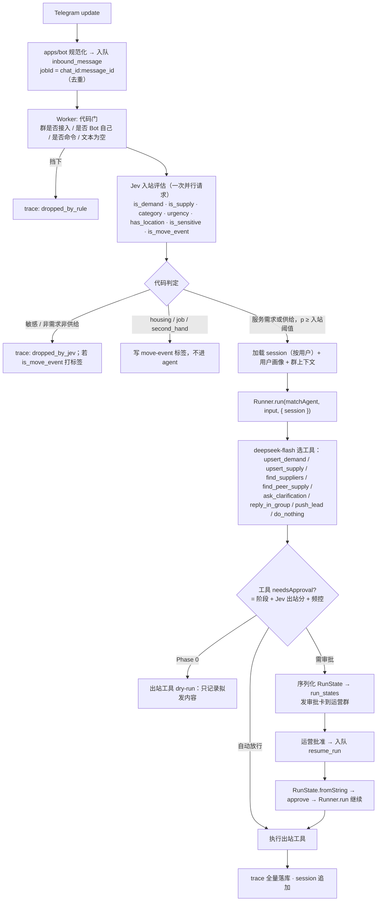

# London Matching Bot 技术架构设计

| 项       | 内容                                                                                                                                              |
| -------- | ------------------------------------------------------------------------------------------------------------------------------------------------- |
| 版本     | v1.0（2026-09-21）                                                                                                                                |
| 上位文档 | [产品需求 v2.0](./support-agent-产品需求.md)、[Project Brief](./London_Matching_Bot_Project_Brief.docx)                                           |
| 参考资料 | [harness 选型对比](./reference/harness-comparison.md)、[Jev 摘要](./reference/jev-decision-model.md)、[dsh 摘要](./reference/deepseek-harness.md) |
| 本文回答 | 系统由哪些模块组成、agent 怎么组织、模型在哪些位置被调用、数据怎么落、人工怎么介入、阶段怎么放行、哪些东西还要验证                                |

---

## 0. 已定决策与假设

| #   | 决策                                                                                                                                 | 状态                                                                                                                                                                                                 |
| --- | ------------------------------------------------------------------------------------------------------------------------------------ | ---------------------------------------------------------------------------------------------------------------------------------------------------------------------------------------------------- |
| D1  | Agent harness 用 **OpenAI Agents SDK**                                                                                               | 已定（2026-09-21）                                                                                                                                                                                   |
| D2  | 生成模型 **deepseek-flash**，走 DeepSeek 的 OpenAI 兼容 Chat Completions 端点                                                        | 已定                                                                                                                                                                                                 |
| D3  | 决策模型 **Jev**（TypeSafe AI），HTTP 直连 `POST /v1/systemone`                                                                      | 已定                                                                                                                                                                                                 |
| D4  | 语言 **TypeScript**（`@openai/agents` 0.18.x）                                                                                       | **假设**。理由：Telegram 库 grammY 成熟；一套语言覆盖 bot、worker、审批台；Agents SDK 的 TS 版 HITL 与 Sessions 已核实可用。Python 版 Sessions 后端更全，若团队更熟 Python，本文模块划分不变，只换库 |
| D5  | 控制器采用 **混合模式**：进 agent 之前由 Jev 加代码做确定性门控，agent 内部由 deepseek-flash 选工具，工具执行前后再由 Jev 加代码把关 | 已定（见 §3）                                                                                                                                                                                        |
| D6  | 首发渠道 Telegram；供应商侧触达 Phase 1 用 Telegram 私聊加人工 WhatsApp                                                              | **假设**，WhatsApp Business API 接入延后                                                                                                                                                             |
| D7  | 审批台 Phase 1 用 **运营私有 Telegram 群加 inline 按钮**，Phase 2 再做 Web 审批台                                                    | **假设**，理由是两周计划里不值得先建 Web                                                                                                                                                             |

## 1. 系统总览

```
┌──────────────┐   ┌──────────────────┐   ┌──────────────┐
│ Telegram 群  │──▶│ Ingestion (grammY)│──▶│ Queue (Redis │
│ / 私聊       │◀──│ 出站发送           │◀──│  BullMQ)     │
└──────────────┘   └──────────────────┘   └──────┬───────┘
                                                  │ job: inbound_message / resume_run / cron
                                                  ▼
┌─────────────────────────────────────────────────────────────────┐
│ Worker                                                          │
│  ┌──────────────┐  ┌──────────────────────┐  ┌───────────────┐  │
│  │ Pre-gate     │─▶│ Agent Runtime         │─▶│ Post-gate     │  │
│  │ 代码 + Jev   │  │ @openai/agents        │  │ 代码 + Jev    │  │
│  │ 要不要进 agent│  │ deepseek-flash + tools│  │ 值不值得发     │  │
│  └──────────────┘  └──────────┬───────────┘  └───────────────┘  │
│                               │ tools                            │
│  ┌────────────┬───────────────┼──────────────┬────────────────┐  │
│  │ Demand 域  │ Supply 域      │ Matcher      │ Outbound       │  │
│  │ 需求/记忆   │ 供应商库+群内供给│ 确定性打分    │ 回复/推 lead    │  │
│  └────────────┴───────────────┴──────────────┴────────────────┘  │
└───────────────────────────────┬─────────────────────────────────┘
                                ▼
┌──────────────────────────────────────────────────────────────────┐
│ Postgres：users · demands · supplies · suppliers · matches ·       │
│ sessions · run_states · decision_traces · group_configs · leads   │
└──────────────────────────────────────────────────────────────────┘
        ▲                          ▲                        ▲
┌───────┴────────┐   ┌─────────────┴───────────┐   ┌────────┴────────┐
│ 审批台          │   │ Cron (BullMQ repeatable) │   │ 看板 / 评测回放  │
│ Phase1 TG 群   │   │ 供应商复核 · 日报 · 过期   │   │ SQL + 回放脚本   │
│ Phase2 Web     │   │                          │   │                 │
└────────────────┘   └──────────────────────────┘   └─────────────────┘
```

设计原则：

1. **Agent 只在需要理解和对话时运行。** 群里大部分消息在 Pre-gate 就被代码和 Jev 挡掉，不进 deepseek-flash。
2. **所有出站动作都是工具，所有工具都有门。** 回复群、私聊用户、推 lead 都是 `tool()`，门由阶段开关、Jev 置信度、频控三者共同决定。
3. **队列是唯一入口。** Telegram 更新先落队列再处理，重试、去重、限流都在队列层。
4. **每一次判断留痕。** Jev 的每次调用、agent 的每次 run、每个门的决定，写进 `decision_traces`，这是审计、评测和成本核算的唯一数据源。

## 2. 模块划分

pnpm monorepo：

| 包                          | 职责                                                                              | 依赖                                          |
| --------------------------- | --------------------------------------------------------------------------------- | --------------------------------------------- |
| `apps/bot`                  | grammY 进程：收 Telegram 更新，规范化为 `InboundMessage` 入队；消费出站队列发消息 | `packages/channel-telegram`、`packages/queue` |
| `apps/worker`               | BullMQ worker：`inbound_message`、`resume_run`、cron 任务                         | 几乎所有包                                    |
| `apps/admin`                | Phase 2 Web 审批台与看板（Phase 1 用 TG 群，见 `packages/approval`）              | `packages/db`                                 |
| `packages/db`               | Prisma schema 与迁移，仓储层                                                      | Postgres                                      |
| `packages/domain`           | Demand / Supply / User / Match 的领域模型与状态机，纯 TS 无 IO                    | 无                                            |
| `packages/jev`              | Jev HTTP 客户端、问题集定义、阈值配置、调用留痕                                   | `packages/db`                                 |
| `packages/agent`            | Agents SDK 组装：Agent 定义、tools、guardrails、session 实现、模型 provider       | `@openai/agents`、`jev`、`domain`、`db`       |
| `packages/matcher`          | 确定性匹配：postcode 覆盖、档期、价格、语言打分                                   | `domain`、`db`                                |
| `packages/channel-telegram` | Telegram 消息 ↔ 规范消息模型；出站发送；群配置读取                                | grammY                                        |
| `packages/approval`         | 审批请求发布（Phase 1 发到运营 TG 群）与决策回收                                  | `channel-telegram`、`db`                      |
| `packages/gating`           | 阶段开关、频控、品类黑名单、群级策略。**纯规则，无模型调用**                      | `db`                                          |
| `packages/eval`             | 从 `decision_traces` 回放、抽检标注、指标计算                                     | `db`、`jev`、`agent`                          |

新渠道（WhatsApp）只加 `packages/channel-whatsapp`，它产出同样的 `InboundMessage`；新品类只改配置、供应商数据和 Jev 的 `criteria`；新动作只加一个 `tool()`。

## 3. 一条消息的旅程



三个门的分工：

| 门     | 位置                                                | 由谁决定          | 决定什么                                                                          |
| ------ | --------------------------------------------------- | ----------------- | --------------------------------------------------------------------------------- |
| 代码门 | Pre-gate                                            | 纯规则            | 群未接入、Bot 自身消息、空文本、黑名单品类、阶段为 Phase 0 时出站工具是否 dry-run |
| 入站门 | Pre-gate                                            | Jev + 阈值        | 要不要为这条消息启动 agent；品类路由；move-event 标签                             |
| 出站门 | 工具的 `needsApproval` 函数 + 工具 output guardrail | 阶段 + Jev + 频控 | 这次出站是自动、送审还是拒绝                                                      |

## 4. Agent 设计（`packages/agent`）

### 4.1 模型接入

```ts
import { Agent, Runner, OpenAIProvider, setDefaultModelProvider } from '@openai/agents';

setDefaultModelProvider(
  new OpenAIProvider({
    baseURL: 'https://api.deepseek.com',
    apiKey: process.env.DEEPSEEK_API_KEY,
    useResponses: false, // DeepSeek 走 Chat Completions
  }),
);
// agent 上 model: 'deepseek-flash'
```

- 不经过 Vercel AI SDK 适配器。DeepSeek 端点本身 OpenAI 兼容，直连最少一层，且适配器仍是 beta。
- 已知限制：Chat Completions 模式没有 tool search、programmatic tool calling、`outputSchema` 的 Responses 专属能力。我们不需要。
- 默认 tracing 会导出到 OpenAI，必须禁用并换成自定义 `TracingProcessor` 写本地（§8）。
- 结构化输出：DeepSeek 支持 JSON schema。抽取字段用 `tool()` 的 zod 参数校验而不是最终 `outputType`，因为抽取本身就是"调 `upsert_demand` 工具"。

### 4.2 一个 agent，多个工具，暂不分 handoff

Phase 0 到 1 用**单个 `matchAgent`**。品类差异通过 `instructions` 的动态函数按当前需求品类注入品类说明，不为每个品类建 agent。Handoff 保留为扩展点：当某品类需要显著不同的对话流程（例如议价）时，再拆出子 agent。

工具清单：

| 工具                | 作用                                                                     | 副作用 | 门     |
| ------------------- | ------------------------------------------------------------------------ | ------ | ------ |
| `upsert_demand`     | 新建或补全当前用户的开放需求（品类、时间、起点、终点、数量、预算、语言） | 写库   | 无     |
| `upsert_supply`     | 记录群内同伴的供给（"周日有 van"）                                       | 写库   | 无     |
| `find_suppliers`    | 调 `packages/matcher` 从供应商库取 Top N（A 池优先）                     | 读     | 无     |
| `find_peer_supply`  | 从群内供给池找匹配                                                       | 读     | 无     |
| `ask_clarification` | 追问缺失字段（群内 @ 或私聊）                                            | 出站   | 出站门 |
| `reply_in_group`    | 在需求消息下回帖供应商选项                                               | 出站   | 出站门 |
| `notify_user`       | 私聊用户（衍生推荐、撮合结果）                                           | 出站   | 出站门 |
| `push_lead`         | 给 A 池供应商发结构化 lead                                               | 出站   | 出站门 |
| `close_demand`      | 用户说已解决                                                             | 写库   | 无     |
| `do_nothing`        | 明确表示本轮不动作，并给理由                                             | 无     | 无     |

出站工具全部实现为：先写 `outbound_messages` 表（状态 `pending`），再由 `apps/bot` 消费发送。Phase 0 的 dry-run 就是状态停在 `dry_run` 不发。

### 4.3 出站门的实现

```ts
tool({
  name: 'reply_in_group',
  parameters: z.object({ demandId: z.string(), text: z.string(), supplierIds: z.array(z.string()) }),
  needsApproval: async (ctx, args) => {
    const phase = await gating.phaseFor(ctx.context.chatId);
    if (phase === 0) return false;                 // dry-run 由 execute 内部处理
    if (phase === 1) return true;                  // 全部送审
    const verdict = await jev.outbound({ draft: args, demand: ctx.context.demand, history: ctx.context.recentReplies });
    const rate = await gating.rateLimitOk(ctx.context.chatId);
    return !(verdict.worth_replying >= T.autoSend && verdict.language_ok >= T.lang && rate);
  },
  outputGuardrails: [{ name: 'no_unverified_supplier', execute: ... }],   // 只允许引用 A 池或人工放行的供应商
  execute: async (args, ctx) => outbound.enqueue(...),
});
```

审批流程：

1. `Runner.run` 返回 `result.interruptions` 非空 → `result.state.toString()` 写 `run_states`（含 `agentVersion`、`sdkVersion`）。
2. `packages/approval` 把拟发内容、候选供应商、置信度渲染成审批卡发到运营群，按钮 `批准 / 改文案 / 换供应商 / 忽略`。
3. 回收决策后入队 `resume_run`。Worker 取出快照，`RunState.fromString(matchAgent, snapshot)`，`state.approve(item)` 或 `state.reject(item, { message })`，再 `Runner.run(matchAgent, state, { session })`。
4. 快照消费必须原子：`run_states.status` 从 `pending` 到 `consumed` 用条件更新，防止重复恢复。这是 SDK 文档明确要求的。
5. 「改文案」不改快照。实现为 reject 原调用并 `state.addInput()` 一条运营指令，让模型按修改重新调用工具；或者直接由运营端旁路发送并把需求标记为 `sent_manually`。Phase 1 先用后者，简单。

**用户在等待审批期间又发了消息**：`state.addInput()` 把新消息塞进暂停的 run，恢复时一并处理。这是 SDK 提供的能力，避免为同一用户开两个并发 run。

### 4.4 Session 与记忆

- **Session 粒度 = 用户**（Telegram user id），不是群，不是消息。同一用户在不同群、不同天的消息进同一个 session，这就是"多次补充需求"的载体。
- 自定义 `Session` 实现存 Postgres（`sessions`、`session_items` 表），实现 SDK 的五个方法；实现 `SessionHistoryTransactionAwareSession` 的 `applyHistoryTransaction` 以获得幂等追加。
- `sessionInputCallback` 裁剪历史：只保留最近 N 轮加所有与当前开放需求相关的项，群里的噪声不进 session（噪声在 Pre-gate 就没进来）。
- **结构化记忆不放在 session 里**。用户画像（常用区域、语言、历史需求）和开放需求状态在 `users` / `demands` 表，通过 `instructions` 动态函数注入当前 run，避免让模型从长历史里自己翻。
- 群上下文（这个群近期回复过什么、群配置）同样注入，不进 session。

### 4.5 Guardrails

| 类型                                      | 用途                                                                                      | 执行                          |
| ----------------------------------------- | ----------------------------------------------------------------------------------------- | ----------------------------- |
| Input guardrail（`runInParallel: false`） | 兜底：进 agent 前再检查一次敏感内容与 PII 过量（例如整段身份证号）                        | Jev `is_sensitive` 加正则     |
| Tool input guardrail on 出站工具          | 引用的 supplier 必须存在且为 A 池或已放行；文本不含电话号码以外的 PII；语言与需求语言一致 | 代码 + Jev `language_ok`      |
| Output guardrail                          | 最终输出不得包含未经工具的承诺（价格保证、平台担保话术）                                  | Jev noul `contains_guarantee` |

## 5. Jev 决策点

| 决策点              | state                                               | questions                                                                                                                                  | 阈值用途                                         |
| ------------------- | --------------------------------------------------- | ------------------------------------------------------------------------------------------------------------------------------------------ | ------------------------------------------------ |
| 入站评估            | 原文、群名、语言、该用户 24h 内消息摘要             | `is_demand` noul、`is_supply` noul、`category` choice、`urgency` score 0–4、`has_location` noul、`is_sensitive` noul、`is_move_event` noul | `is_demand ∨ is_supply ≥ T.in` 才进 agent        |
| 出站评估            | 拟发文案、需求结构、候选供应商摘要、该群近 24h 回复 | `worth_replying` score 0–3、`language_ok` noul、`mentions_unverified` noul                                                                 | Phase 2 自动放行阈值                             |
| 供应商贴合          | 需求结构 + 单个供应商记录                           | `fit` score 0–4                                                                                                                            | 与 matcher 的确定性分数加权，只在候选 > N 时调用 |
| 审批分流（Phase 2） | 出站评估结果 + 频控状态                             | `route` choice: auto / review / drop                                                                                                       | 直接映射 `needsApproval` 返回值                  |

约束：同一请求内问题互相独立；有依赖的判断拆两次。阈值全部放 `gating` 的配置表，Phase 0 结束后用标注样本校准，不写死。

Jev 客户端要求：单次 HTTP 请求（包括响应体读取）默认超时 5s，调用方更短的 deadline 优先；429/529 指数退避 3 次，失败时**入站门按"不进 agent"处理、出站门按有人值守送审／无人值守 drop 处理**，永不因为 Jev 不可用而自动发。2026-10-17 原群验收发现 3s 边界失败，冻结流式响应测试验证 3.5s 正常完成、5s 仍有界中止；响应体中止记 timeout，合法时限内的坏 JSON 才记 invalid_response。

### 5.x 2026-10-20：`JEV_POLICY=off`

联合实测（`docs/evaluations/2026-10-20-actor-bots-joint-run.md`）后新增的运行模式：不调用 Jev。入站门改为一次生成模型分诊（`packages/agent/src/triage.ts`），输入包含最近 20 条群内公开消息（成员以别名出现）和当前消息，输出 `answer / continue / peer_offer / acknowledge / ignore` 与品类；出站门只保留阶段、频控和代码事实校验。是否回复以“对提问者有没有价值”判定：未 @ 助手的群消息在没有有用内容时保持沉默，不发固定状态。

## 6. 数据模型（`packages/db`）

| 表                           | 关键字段                                                                                                                                                       | 说明                    |
| ---------------------------- | -------------------------------------------------------------------------------------------------------------------------------------------------------------- | ----------------------- |
| `users`                      | tg_user_id, languages[], home_postcode?, profile_json, last_seen                                                                                               | 跨群用户画像            |
| `groups`                     | tg_chat_id, name, phase(0/1/2), categories_enabled[], admin_contact, rate_limit_per_day                                                                        | 群级配置                |
| `messages`                   | id, chat_id, tg_message_id, user_id, text, lang, received_at                                                                                                   | 原始消息，保留期见 §9   |
| `demands`                    | id, user_id, category, status(open/clarifying/matched/closed/expired), when, from_pc, to_pc, quantity, budget, confidence, source_message_ids[], is_move_event | 需求生命周期            |
| `supplies`                   | id, user_id, chat_id, category, availability, area, expires_at, source_message_id                                                                              | 群内供给池              |
| `suppliers`                  | Brief §3 字段 + pool(A/B), last_verified, contacted, willing_to_receive_leads                                                                                  | 供应商库                |
| `matches`                    | demand_id, supplier_id or supply_id, matcher_score, jev_fit, rank                                                                                              | 撮合结果                |
| `leads`                      | match_id, sent_via, sent_at, supplier_response(quote/pass/none), converted, paid                                                                               | 回访与漏斗              |
| `sessions` / `session_items` | user_id, seq, item_json, operation_id                                                                                                                          | Agents SDK Session 存储 |
| `run_states`                 | id, user_id, snapshot(text), agent_version, sdk_version, status(pending/consumed/expired), interruptions_json                                                  | HITL 快照               |
| `approvals`                  | run_state_id, reviewer, decision, edited_text?, decided_at                                                                                                     | 审批记录                |
| `outbound_messages`          | channel, target, text, status(dry_run/pending/sent/failed), tool_call_id                                                                                       | 出站队列表              |
| `decision_traces`            | kind(rule/jev/agent_run/gate), input_ref, output_json, latency_ms, cost, phase                                                                                 | 全量判断留痕            |

`decision_traces` 是评测与看板的唯一来源；PRD §9 的每个指标都能由它和 `leads` 算出。

## 7. 阶段放行（`packages/gating`）

| 阶段           | 入站                    | agent                                        | 出站工具                                 | 审批       |
| -------------- | ----------------------- | -------------------------------------------- | ---------------------------------------- | ---------- |
| Phase 0 Shadow | 全量 Jev 评估，落 trace | 对通过入站门的消息**照常运行**，产出拟发内容 | `dry_run`，一律不发                      | 无         |
| Phase 1        | 同上                    | 同上                                         | `needsApproval = true`                   | 运营群审批 |
| Phase 2        | 同上                    | 同上                                         | `needsApproval` 由 Jev 出站分 + 频控决定 | 仅送审部分 |

Phase 0 就让 agent 跑起来的原因：Shadow 期要验证的不只是"需求密度"，还有"agent 会怎么回"。dry-run 的拟发内容就是 Phase 1 前的离线评测集。

群级 `phase` 可以单独设置，一个群出问题可以单独降级，不影响其他群。

## 8. 观测、评测、成本

- **Tracing**：注册自定义 `TracingProcessor`，把 span 写入 `decision_traces`（kind = agent_run），禁用默认导出。后续可加 OTel exporter。
- **回放**：`packages/eval` 从 `messages` 抽样，重跑 Pre-gate 与 agent（出站 dry-run），与人工标注比对，输出 Intent precision、字段准确率、沉默正确率。
- **成本**：每条 trace 记 token 与 Jev input tokens，按群、按天聚合，得到"每 1000 条群消息花多少钱"。预期 Phase 0 绝大多数消息只花一次 Jev 调用（约 400 token，$0.042/M），deepseek-flash 只在通过入站门后调用。

## 9. 隐私与合规

- UK GDPR 适用。`messages` 原文保留 30 天后只留结构化字段与哈希；`users` 里的联系方式只在需求 open 期间保存。
- 供应商电话是公开商业信息，可长期保存；群成员的联系方式只在用户明确让 Bot 转达时写入 `leads`。
- 禁用 Agents SDK 默认 tracing 导出（数据不出境到 OpenAI）。
- Jev 请求启用 Zero Data Retention 选项。
- DeepSeek API 的数据处理条款需要合规审阅，这是 D2 的前置风险，不在本文范围内解决。
- `RunState` 快照含对话与工具参数，落库加密列，保留期 7 天后 `expired`。

## 10. 扩展路径

| 扩展                        | 改动点                                                                                      |
| --------------------------- | ------------------------------------------------------------------------------------------- |
| 新品类（handyman、storage） | `groups.categories_enabled`、Jev `category.criteria`、供应商数据、`instructions` 的品类说明 |
| 新渠道（WhatsApp）          | `packages/channel-whatsapp` 产出 `InboundMessage`；`outbound_messages.channel` 新值         |
| 新动作（预约、议价）        | 新 `tool()` 加出站门；若对话流程差异大，拆子 agent 用 handoff                               |
| 供应商自助接入              | `apps/admin` 加供应商端；`leads` 表已预留                                                   |
| 收费（Phase 2）             | `leads.paid` 加账单表；不影响 agent                                                         |

## 11. 风险与待验证（PoC 清单，写代码前先跑）

| #   | 验证项                                                                                                      | 通过标准                                     |
| --- | ----------------------------------------------------------------------------------------------------------- | -------------------------------------------- |
| V1  | `OpenAIProvider({ baseURL: DeepSeek, useResponses: false })` + `deepseek-flash` 的多工具调用与 zod 参数校验 | 10 条样例消息中 ≥ 9 条正确调 `upsert_demand` |
| V2  | `needsApproval` 中断 → `toString` 落库 → 另一进程 `fromString` → approve → 继续，且期间 `addInput` 生效     | 端到端跑通，快照重复消费被拒绝               |
| V3  | 自定义 Postgres `Session` 与 `sessionInputCallback` 裁剪                                                    | 同一用户跨两个群的两条消息合并到一个需求     |
| V4  | Jev 入站问题集在 50 条真实群消息上的 precision，延迟                                                        | precision ≥ 0.9，p95 < 2s                    |
| V5  | grammY 收群消息的权限（Bot 需关闭 privacy mode 或成为管理员）                                               | 首批 8 个群里能收到非 @ 消息                 |
| V6  | 禁用默认 tracing 后自定义 processor 能拿到完整 span                                                         | trace 表有 run / tool / model 三层           |

已知的长期风险：Agents SDK 升级会让旧 `RunState` 快照不可恢复，官方建议按版本双装。缓解：快照 7 天过期，升级前清空待审队列。

## 12. 与两周计划的对应

| Day   | 本文模块                                                              |
| ----- | --------------------------------------------------------------------- |
| 1–2   | `packages/db`、`suppliers` 录入、`packages/jev` 客户端 + V4           |
| 2–5   | `apps/bot` 接入群 + V5、`packages/gating` 阶段开关、Pre-gate          |
| 4–8   | Phase 0：`packages/agent` dry-run + V1/V3、`decision_traces` 看板 SQL |
| 7–11  | Phase 1：`packages/approval` 运营群审批 + V2、`push_lead`             |
| 10–14 | `leads` 回访录入、指标计算                                            |
| 14    | Go / Pivot；Go 后进入 Phase 2 阈值校准                                |
